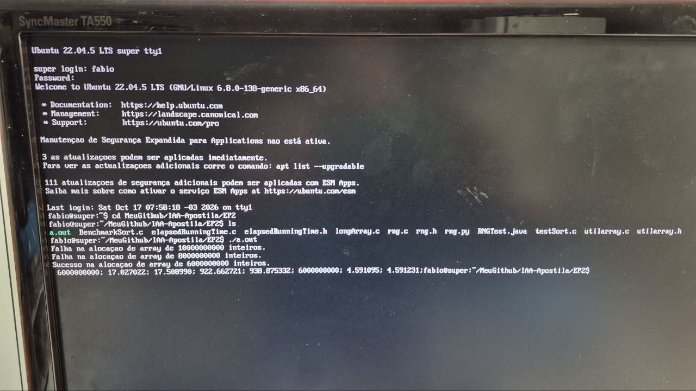

Figura 1 - Captura de tela da execução do programa fornecido nesta pasta.
O programa aloca o array de inteiros mais longo possível, dentro de um conjunto
de comprimentos, preenche o array com valores gerados aleatoriamente, ordena o
array usando a função `qsort(...)` da biblioteca `glibc` (header `stdlib.h`) e 
verifica se o array resultante está ordenado em ordem crescente. Os valores
impressos na tela são: 1) comprimento do array, 2) tempo transcorrido, 
em segundos, para 
preencher o array medido com a função `clock(...)`, 3) tempo transcorrido, 
em segundos, para 
preencher o array medido com a função `gettimeofday(...)`, 4) tempo 
transcorrido, em segundos, para ordenar o array medido com a 
função `clock(...)`, 5) tempo transcorrido, em segundos, para ordenar o array 
medido com a função `gettimeofday(...)`, 
6) comprimento da sequência crescente a partir do primeiro elemento do array, 
7) tempo transcorrido, em segundos, para obter o comprimento apresentado no 
ítem 6 medido com a função `clock(...)`, 
8) tempo transcorrido, em segundos, para para obter o comprimento apresentado 
no ítem 6 medido com a função `gettimeofday(...)`.  

Figura 2 - Exemplo de compilação e execução de `secret.c`

# Medir tempo de execução de algoritmos de ordenação

## Contextualização (organização do código-fonte deste teste)

## Procedimento sugerido para colocar este teste funcionando
1. 

## Procedimento sugerido para cumprir a tarefa

## Indicadores de cumprimento da tarefa

